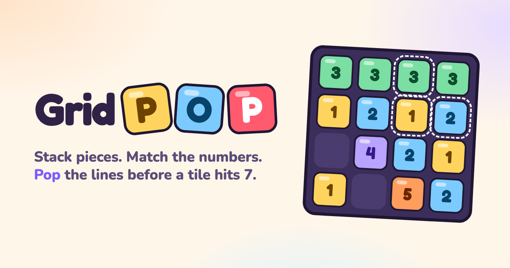
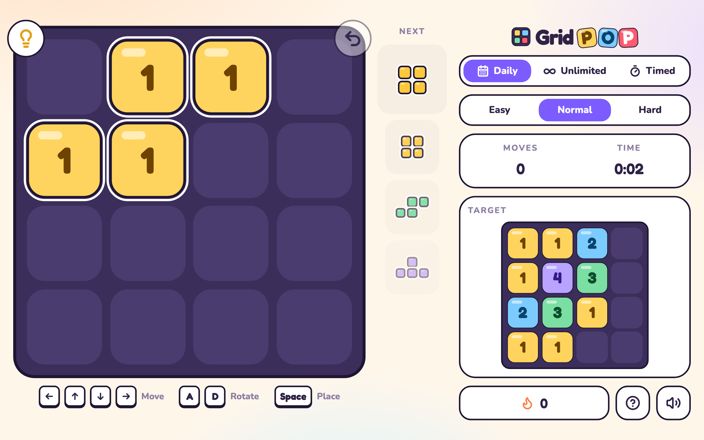

# GridPop



Stack pieces, match the numbers, and pop the lines before a tile hits 7.
**Play it at https://jamesurobertson.github.io/gridpop/**




## Daily puzzle

The game opens on the daily puzzle: everyone gets the same pieces in the same order and tries to
build the target board in as few placements as possible, with time breaking ties. A new puzzle
starts at midnight UTC. Unlimited and Timed are the endless modes.

Puzzles live in `src/data/dailyPuzzles.json`, made ahead of time by

```bash
node scripts/generate-daily.mjs 2027-05-04 60   # first date, number of days
```

which builds each day's target from its seeded pieces and searches every line of play for par. Days
already in the file are kept, so it only adds new ones. Every day is built from 4 pieces for now;
`DIFFICULTY_BY_WEEKDAY` in the script can make some days longer or require a line pop. Add
`?date=YYYY-MM-DD` to the URL to play another day's puzzle; only today's counts toward streaks.

## Getting Started

1. Clone the repository
2. Install dependencies with `npm install`
3. Run the development server with `npm run dev`

## Development

The project is built with:

- React
- TypeScript
- Tailwind CSS
- Vite

## Building for Production

To build the project for production:

```bash
npm run build
```

The built files will be in the `dist` directory.

## Deploying

Every push to `master` builds the game and publishes it to GitHub Pages at
https://jamesurobertson.github.io/gridpop/ (`.github/workflows/deploy.yml`). The site is served from
`/gridpop/`, which `vite.config.ts` sets as the base path.

## Credits

Sound effects: [Interface Sounds](https://kenney.nl/assets/interface-sounds) and
[Music Jingles](https://kenney.nl/assets/music-jingles) by Kenney (CC0). Fonts: Fredoka and Nunito (Google Fonts, OFL).
